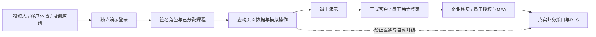

# 演示、客户体验、员工培训与Production接入

2026-11-11（温哥华）。采用最小权限、默认拒绝、职责分离、环境隔离和账号生命周期管理等通行安全原则；不是ISO/SOC认证或外部合规审计结论。

## 角色与边界

| 主角色 | 可见数据 | 可执行操作 | 始终禁止 |
| --- | --- | --- | --- |
| 投资人 investor | 虚构业务总览、双层收费示例、客户及销售只读视角 | 切换只读视角、下载示例账单 | 修改资料、执行训练、真实财务、用户授权、密钥、源代码或部署 |
| 客户体验 client | 当前页面的演示企业、预算、虚构账单和指标 | 模拟建档、预算、账单问题和CSV下载；重置 | 其他访客数据、真实客户或余额、广告投放、定价配置、员工权限 |
| 员工培训 training | 邀请人分配的虚构岗位案例 | 在指定课程内模拟操作，重置练习 | 真实CRM、财务批准、客户资料、广告API、员工授权；课程完成不能自动提权 |

员工培训支持 `sales`（销售/客服）、`ad_operations`（加拿大广告执行）、`finance_preparer`（制单）、`finance_reviewer`（独立复核）。账号JSON的`trainingTracks`须由配置管理者明确指定；未填时只分配销售，不默认开放所有岗位。重复、未知或对非培训账号设置课程的配置会被拒绝。旧`sales`演示角色仅为已发放邀请兼容保留，不自动升级为多岗位培训。

投资人切换的是演示展示，不是真实身份或权限。客户/销售表单及培训仅改变浏览器当前页内存；没有真实企业、付款、账单、广告或培训证书生成。财务练习保留自审拒绝、另一账号复核及发布独立办理的说明，不以模拟批准冒充真实审核。

## 同一正式网站中的三个独立入口

| 地址 | 身份与数据来源 |
| --- | --- |
| `/zh/demo/login` → `/zh/demo` | 独立演示账号和签名会话；虚构、可清空的页面数据 |
| `/zh/login` → `/zh/account` | 正式客户认证；核实企业成员及财务授权后的真实企业数据 |
| `/zh/admin/login` → `/zh/admin`、`/zh/operations` | 正式员工认证、MFA、单位职责和企业访问控制 |

英文用`/en`。三者可部署在同一Production项目中，URL并不授予权限。不新增公共首页入口、不更改域名或DNS；可直接把演示网址发给受邀人。Production发布仍须单独授权。

## 已实现的防混用控制

- 演示会话单独签名，最多8小时且不超过账号到期时间；每次进入演示页面从服务器当前配置重新核对角色、课程和有效期。
- 所有真实`/api/*`请求在带演示cookie时由网关返回403（`demo_only`）；只允许`/api/demo/*`处理演示登录/退出，不向业务处理函数转发。正常无演示cookie的请求继续原有鉴权，网关放行本身不代表授权。
- 真实客户/员工页面在带演示cookie时返回演示中心。底层`authClient`也拒绝提供真实Supabase会话，避免同一浏览器中遗留的管理员登录被演示页面继承；这同时保护真实读取、导出和写入。
- 演示退出只清除演示cookie，不删除正式员工的Supabase会话。账号过期/停用后的登录页也有退出入口，避免旧cookie阻断正常登录；退出后真实账号仍需按原权限鉴权。
- 真实业务保护以演示cookie存在为准，即使签名损坏或账号已停用也不回退使用浏览器中遗留的真实身份。伪造cookie不会提权，只会令该浏览器进入拒绝访问状态，可通过演示退出恢复。
- 仍应使用独立浏览器配置文件给访客，绝不把已登录管理员的浏览器窗口交给投资人。演示退出后可能恢复该浏览器原来的真实身份，这是身份拥有者的会话，并非演示账号获得权限。
- 演示账号由服务器私有配置发放，无公开注册或浏览器提权接口。修改账号角色、课程、哈希或到期时间会改变会话版本；同一配置生效后旧会话失效。停用需覆盖仍可访问的旧部署。

## Production配置与上线顺序

1. 继续在Preview验收，独立配置三项演示变量与现有持久登录限流。不复制Production客户数据库，不复制银行原件/联系人，不把生产广告密钥提供给演示组件。
2. 按人或活动发放独立用户名、随机强密码与到期时间。使用更新后的生成脚本默认生成investor、client、training；培训默认只有sales课程。需要财务课程时由配置管理者在对应培训账号设置`trainingTracks`，不能由学员自行申请成为审核人。
3. Production使用自己的一套`DEMO_SESSION_SECRET`和账号配置，不能直接把Preview演示密钥、已发密码或会话复制过去。正式Auth、Ads及资金配置保持独立；演示模块只复用持久登录限流基础设施，不查询业务表。
4. 明确授权发布后，部署同一代码。未开通演示账号时演示登录保持不可用；不能用静态账号或无保护登录降级替代。
5. 先核对演示登录、每类角色、培训课程、CSV及退出，再验证带演示cookie访问真实页面/API均拒绝。最后退出演示，用真实获授权账号检查原后台功能。
6. 账号失效、移除和角色/课程更改后测试旧会话失效。保留应用部署日志作技术排查；当前版本未实现完整的逐人审计日志/集中撤销控制台，不把它说成已交付的审计平台。

## 体验转为正式使用

**客户**：退出演示 → 正式注册并提交真实企业申请 → 核实企业及人员授权 → 管理员开通成员和财务查看权限 → 使用新的真实记录。演示企业名、预算、余额和账单不自动搬入正式数据库。

**员工**：完成培训后由负责人线下确认 → 管理员通过既有正式账号与单位职责配置授权 → 员工完成正式认证和MFA → 仅办理获授权职责。制单、复核和发布仍按真实职责分离执行，管理员也不能凭培训结果自审。

**投资人**：演示体验默认不转成任何正式角色。若确有查看真实经营指标的需要，应另建脱敏、只读的经营报告权限并独立审批，不授予管理员或财务后台权限。

## 当前实现与后续范围

已实现三个主角色、按课程分配培训、会话生命周期、同浏览器防混用、真实页面/API隔离、虚构操作和下载。无SQL迁移，无真实业务写入，无Production发布。

持久化的多人培训空间、培训考试/证书、逐人审计和集中撤销后台、投资人真实经营看板、SSO等可作为后续功能；如需持久化体验数据，优先独立Demo项目/数据库及合成数据种子，不能直接复用Production业务表或复制真实客户数据。

验证：全库146文件810项全部通过；`test:demo`的9文件25项通过；类型、Next构建、SQL汇总一致性通过。新增覆盖同一浏览器同时携带真实和演示cookie时，真实接口读写均拒绝、底层真实会话不可用、退出恢复正常鉴权、课程变更撤销旧会话、未授权课程拒绝以及模拟自审拒绝。未进行Production环境配置或真实账号发放。

构建后浏览器另通过13个场景：三个有效签名演示角色（投资人、客户、培训）×中英文×手机/桌面，加未登录跳转；包含模拟自审拒绝、课程与页面重置、CSV下载、真实页面重定向及真实API读取/写入403。使用本机临时配置，不代表Vercel账号已开通。
